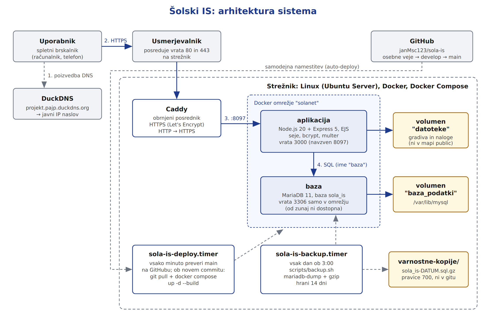

# Namestitev in konfiguracija strežnika

Avtor: Jan Marko (vzdrževalec IS)

Ta dokument opisuje, kako je sistem zgrajen, kako ga namestiš na nov strežnik in kako ga vzdržuješ.
Za branje ne potrebuješ poznati projekta, potrebuješ pa osnove Linuxa in Dockerja.

## 0. Arhitektura sistema


Pot ene zahteve:
1. Brskalnik vpraša DuckDNS za IP naslov domene `projekt.pajp.duckdns.org`.
2. Zahteva HTTPS pride do domačega usmerjevalnika, ki vrata 80 in 443 posreduje na strežnik.
3. Caddy na strežniku preveri potrdilo (HTTPS) in zahtevo posreduje aplikaciji na vrata 8097.
4. Aplikacija (Node.js + Express) v vsebniku prebere ali zapiše podatke v bazo MariaDB, ki je v
   istem Docker omrežju `solanet` in od zunaj ni dosegljiva.
5. Naložene datoteke (gradiva, naloge) so v Docker volumnu `datoteke`, podatki baze v volumnu
   `baza_podatki`. Oba ostaneta, tudi če vsebnike izbrišemo in ponovno zgradimo.

Na strežniku tečeta še dva systemd časovnika: `sola-is-deploy.timer` (samodejna namestitev nove
različice z GitHuba) in `sola-is-backup.timer` (dnevna varnostna kopija baze).

## 1. Strežnik
| | |
|---|---|
| Operacijski sistem | Linux (Ubuntu Server) |
| Programska oprema | Docker, Docker Compose, Git, Caddy (obrnjeni posrednik) |
| Mapa projekta | `~/stacks/sola-is` |
| Javna domena | https://projekt.pajp.duckdns.org |

Domača omrežna povezava ima javni IP naslov. Poddomena `pajp.duckdns.org` (DuckDNS) kaže nanj,
usmerjevalnik pa vrata 80 in 443 posreduje na strežnik, kjer jih sprejme Caddy.

## 2. Prva namestitev
```bash
# 1) prenos kode
git clone https://github.com/janMsc123/sola-is.git ~/stacks/sola-is
cd ~/stacks/sola-is

# 2) okoljske spremenljivke (gesla niso v gitu)
cp .env.example .env
nano .env                         # nastavi gesla; SESSION_SECRET: openssl rand -hex 32

# 3) zagon
docker compose up -d --build

# 4) preverjanje
docker compose ps                 # oba vsebnika "Up", baza "healthy"
curl http://localhost:8097/api/health    # {"status":"ok","db":true}
```
Ob prvem zagonu MariaDB izvede skripte iz `db/init/` po abecedi: najprej `01-schema.sql` (tabele),
nato `02-testni-podatki.sql`. To se zgodi samo, ko je volumen baze prazen.

**Ponastavitev baze na testne podatke** (pobriše vse podatke!):
```bash
docker compose down
docker volume rm sola-is_baza_podatki
docker compose up -d
```

## 3. Okoljske spremenljivke (`.env`)
| Spremenljivka | Namen |
|---|---|
| `DB_ROOT_GESLO` | geslo uporabnika root v MariaDB (uporablja ga samo varnostna kopija) |
| `DB_NAME` | ime baze (`sola_is`) |
| `DB_USER`, `DB_PASSWORD` | uporabnik, s katerim se poveže aplikacija |
| `SESSION_SECRET` | ključ za podpis piškotka seje; če ga kdo pozna, lahko ponaredi prijavo |

## 4. Vsebniki (`docker-compose.yml`)
| Storitev | Slika | Vrata | Volumen |
|---|---|---|---|
| `baza` | `mariadb:11` | nima (samo notranje omrežje) | `baza_podatki` → `/var/lib/mysql` |
| `aplikacija` | zgrajena iz `app/Dockerfile` (`node:20-alpine`) | `8097` → `3000` | `datoteke` → `/app/datoteke` |

Obe storitvi sta v notranjem omrežju `solanet`. Aplikacija bazo najde po imenu `baza`.
Aplikacija se zažene šele, ko healthcheck baze sporoči, da je pripravljena.

## 5. Obrnjeni posrednik in HTTPS (Caddy)
Caddy sprejme zahteve na vratih 80/443 in jih posreduje aplikaciji. Potrdilo Let's Encrypt
pridobi in obnavlja sam, HTTP pa samodejno preusmeri na HTTPS.

Del datoteke `Caddyfile`:
```
projekt.pajp.duckdns.org {
    reverse_proxy 192.168.0.50:8097
}
```
Po spremembi: `docker exec caddy caddy reload --config /etc/caddy/Caddyfile`.

Ker Caddy aplikacijo doseže prek IP naslova strežnika, mora aplikacija poslušati na `0.0.0.0`
(v `server.js`), ne samo na `localhost`.

## 6. Varnost
- **Gesla uporabnikov** so zgoščena z bcrypt (10 krogov); v bazi je samo zgoščena vrednost.
- **Baza** nima odprtih vrat navzven.
- **Aplikacija teče kot uporabnik `node`**, ne kot root (`USER node` v Dockerfile).
- **Naložene datoteke** so v volumnu `datoteke`, ki ni v mapi `public`. Mapa ima pravice `750`
  (lastnik `node`), zato jih drugi uporabniki ne morejo brati. Prenos gre samo prek poti, ki
  preverijo, ali ima prijavljeni uporabnik pravico do predmeta.
- **Gesla za bazo** so v `.env`, ki je v `.gitignore`.
- **Seja** poteče po 2 urah.

## 7. Samodejna namestitev (auto-deploy)
Systemd timer vsako minuto preveri vejo `main` na GitHubu. Če je nov commit, naredi
`git pull` in `docker compose up -d --build`. Podrobnosti: `scripts/systemd/README.md`.

## 8. Varnostne kopije baze
Skripta `scripts/backup.sh` z `mariadb-dump` izvozi celotno bazo, jo stisne z gzip in shrani v
`varnostne-kopije/` (pravice 700, ni v gitu). Hrani kopije zadnjih 14 dni.

Zagon vsak dan ob 3:00 prek systemd:
```bash
sudo cp scripts/systemd/sola-is-backup.service scripts/systemd/sola-is-backup.timer /etc/systemd/system/
sudo systemctl daemon-reload
sudo systemctl enable --now sola-is-backup.timer
```
Ročna kopija: `./scripts/backup.sh`

**Obnovitev iz kopije:**
```bash
gunzip -c varnostne-kopije/sola_is-2026-10-11_0300.sql.gz \
  | docker compose exec -T baza mariadb -uroot -p"$DB_ROOT_GESLO" sola_is
```

## 9. Zgradba aplikacije
| Datoteka / mapa | Kaj vsebuje |
|---|---|
| `app/server.js` | vstopna točka: nastavitve Expressa, seje, poti, strani za napake |
| `app/db.js` | povezava z bazo (bazen povezav `mysql2`) |
| `app/preveri.js` | preverjanje pravic: `samo('administrator')` in podobno |
| `app/datoteke.js` | nastavitve za nalaganje datotek (multer, največ 20 MB) |
| `app/routes/prijava.js` | prijava, registracija učenca, odjava |
| `app/routes/admin.js` | CRUD predmetov, učiteljev in učencev ter povezave s predmeti |
| `app/routes/ucitelj.js` | gradiva in pregled oddanih nalog |
| `app/routes/ucenec.js` | profil, izbira predmetov, gradiva, oddaja nalog |
| `app/views/` | HTML predloge (EJS), ena mapa za vsak pogled |
| `db/init/` | SQL za tabele in testne podatke (izvede se ob prvem zagonu) |
| `scripts/` | auto-deploy, varnostna kopija, systemd enote |

Podatkovni model (8 tabel) je opisan v [specifikacija.md](specifikacija.md), slika je v
[er-diagram.png](er-diagram.png).

## 10. Vsakdanje vzdrževanje
| Opravilo | Ukaz (v mapi projekta) |
|---|---|
| stanje vsebnikov | `docker compose ps` |
| dnevnik aplikacije (napake) | `docker compose logs -f aplikacija` |
| ponovni zagon | `docker compose restart aplikacija` |
| ročna posodobitev | `git pull && docker compose up -d --build` |
| dnevnik samodejne namestitve | `cat deploy.log` |
| stanje časovnikov | `systemctl list-timers 'sola-is-*'` |
| ročna varnostna kopija | `./scripts/backup.sh` |
| konzola baze | `docker compose exec baza mariadb -u"$DB_USER" -p sola_is` |

## 11. Odpravljanje težav
| Težava | Kaj preveriti |
|---|---|
| Stran se ne odpre | `docker compose ps`: ali oba vsebnika tečeta? `curl localhost:8097/api/health` na strežniku |
| `/api/health` vrne napako baze | `docker compose logs baza`; ali so gesla v `.env` enaka kot ob prvem zagonu baze |
| Lokalno deluje, na domeni ne | ali Caddy teče, ali domena kaže na pravi IP (`nslookup projekt.pajp.duckdns.org`) |
| "Prišlo je do napake na strežniku." | podrobnosti so v `docker compose logs aplikacija` |
| Nova različica se ni namestila | `deploy.log` in `systemctl status sola-is-deploy.timer` |
| Testni podatki se niso naložili | skripte v `db/init/` se izvedejo samo na prazni bazi (glej poglavje 2) |

