# Testiranje

Testni primeri za vse tri poglede (teden 5). Vsak primer ima opis, pričakovani in dejanski rezultat ter status.

| | |
|---|---|
| Datum testiranja | 30. 10. 2026 |
| Okolje | ločena kopija aplikacije (`docker compose -p sola-is-test`) s svežimi testnimi podatki, brskalnik Chromium |
| Način | testi so zapisani kot skripta (Playwright), ki klika po aplikaciji kot pravi uporabnik in naredi zaslonske slike |
| Rezultat | **55 od 59** testov uspešnih, 4 napake zapisane kot GitHub Issues |

Status: **OK** = dejanski rezultat je enak pričakovanemu, **NAPAKA** = ni (povezava na Issue).

## Skupno (vsi uporabniki)

| ID | Opis | Pričakovani rezultat | Dejanski rezultat | Status |
|---|---|---|---|---|
| T01 | Odpiranje domače strani brez prijave | preusmeritev na /prijava | /prijava | OK |
| T02 | Prijava z napačnim geslom | sporočilo "Napačen email ali geslo." | sporočilo prikazano | OK |
| T03 | Prijava z neobstoječim emailom | enako sporočilo kot pri napačnem geslu | enako sporočilo | OK |
| T04 | Odpiranje /admin, /ucitelj, /ucenec brez prijave | preusmeritev na /prijava | /prijava | OK |
| T05 | Neobstoječa stran | stran 404 "Stran ne obstaja." | status 404 | OK |
| T06 | Preverjanje delovanja /api/health | {"status":"ok","db":true} | {"status":"ok","db":true} | OK |
| T07 | Neposreden dostop do mape z naloženimi datotekami | 404, datoteke niso javne | status 404 | OK |

## Administrator

| ID | Opis | Pričakovani rezultat | Dejanski rezultat | Status |
|---|---|---|---|---|
| T08 | Prijava administratorja, domača stran s številom zapisov | preusmeritev na /admin, 10 predmetov, 20 učiteljev, 100 učencev | /admin (10,20,100) | OK |
| T09 | Dodajanje predmeta "Psihologija" | predmet je na seznamu | na seznamu | OK |
| T10 | Dodajanje predmeta z obstoječim nazivom | napaka "Predmet s tem nazivom že obstaja." | napaka prikazana | OK |
| T11 | Dodajanje predmeta s praznim nazivom (samo presledki) | napaka "Vpišite naziv predmeta." | napaka prikazana | OK |
| T12 | Urejanje naziva predmeta | nov naziv "Psihologija in filozofija" na seznamu | spremenjeno | OK |
| T13 | Preimenovanje predmeta v naziv, ki že obstaja (Matematika) | napaka, naziv ostane | napaka prikazana | OK |
| T14 | Brisanje predmeta | predmet izgine s seznama | izbrisan | OK |
| T15 | Nov učitelj brez izbranega predmeta | napaka "Izberite vsaj 1 predmet(a)." | napaka prikazana | OK |
| T16 | Nov učitelj s predmetoma Fizika in Informatika | učitelj na seznamu s "Fizika, Informatika" | na seznamu s predmetoma | OK |
| T17 | Nov učitelj z emailom, ki že obstaja | napaka "Ta email že uporablja drug uporabnik." | napaka prikazana | OK |
| T18 | Nov učitelj s prekratkim geslom (3 znaki) | napaka "Geslo mora imeti vsaj 6 znakov." | napaka prikazana | OK |
| T19 | Urejanje učitelja: zamenjava predmeta in novo geslo | naslov "Uredi učitelja", predmeta "Fizika, Kemija" | Uredi učitelja; predmeta spremenjena | OK |
| T20 | Iskanje učenca po priimku "Zorko" | prikazani samo učenci s priimkom Zorko | 2 zadetka, oba s priimkom Zorko | OK |
| T21 | Nov učenec z enim samim predmetom | napaka "Izberite vsaj 2 predmet(a)." | napaka prikazana | OK |
| T22 | Nov učenec s predmetoma Matematika in Slovenščina | učenec na seznamu | na seznamu | OK |
| T23 | Prijava urejenega učitelja z novim geslom | prijava uspe, učitelj vidi Fiziko in Kemijo | /ucitelj | OK |
| T24 | Brisanje učitelja | učitelj izgine s seznama, njegov račun ne deluje več | izbrisan | OK |
| T56 | Brisanje predmeta z gradivi in nalogami: datoteke na disku | zapisi in datoteke se pobrišejo | zapisi pobrisani, datotek ostalo na disku: 3 | **NAPAKA** ([#6](https://github.com/janMsc123/sola-is/issues/6)) |

## Učitelj

| ID | Opis | Pričakovani rezultat | Dejanski rezultat | Status |
|---|---|---|---|---|
| T25 | Prijava učiteljice Petre Bizjak, seznam predmetov | vidi samo Biologijo in Matematiko | samo svoja predmeta | OK |
| T26 | Nalaganje gradiva s šumniki v imenu | gradivo "Celica in šumniki čšž.pdf" na seznamu | ime pravilno | OK |
| T27 | Prenos naloženega gradiva | datoteka se prenese s pravim imenom | Celica in šumniki čšž.pdf | OK |
| T28 | Brisanje gradiva | gradivo izgine s seznama | izbrisano | OK |
| T29 | Nalaganje brez izbrane datoteke | napaka "Izberite datoteko." | napaka prikazana | OK |
| T30 | Odpiranje predmeta, ki ga ne poučuje (Slovenščina) | 403 "Tega predmeta ne poučujete." | status 403 | OK |
| T31 | Vsiljeno nalaganje gradiva k tujemu predmetu (ročna zahteva POST) | 403, nič se ne shrani | status 403 | OK |
| T32 | Učitelj odpre /ucenec in /admin | 403 "Do te strani nimate dostopa." | status 403 / 403 | OK |
| T53 | Pregled oddanih nalog pri Biologiji | vidi nalogo "Novak Nina - Domača naloga 1.pdf" | naloga vidna | OK |
| T54 | Prenos oddane naloge | datoteka "Novak Nina - Domača naloga 1.pdf" | Novak Nina - Domača naloga 1.pdf | OK |

## Učenec

| ID | Opis | Pričakovani rezultat | Dejanski rezultat | Status |
|---|---|---|---|---|
| T33 | Registracija z neujemajočima se gesloma | napaka "Gesli se ne ujemata.", vpisani podatki ostanejo | napaka prikazana | OK |
| T34 | Registracija z emailom, ki že obstaja | napaka "Uporabnik s tem emailom že obstaja." | napaka prikazana | OK |
| T35 | Uspešna registracija novega učenca | samodejna prijava in preusmeritev na izbiro predmetov | /ucenec/predmeti | OK |
| T36 | Izbira samo enega predmeta | napaka "Izberite vsaj 2 predmeta." | napaka prikazana | OK |
| T37 | Izbira treh predmetov (Biologija, Matematika, Informatika) | domača stran z izbranimi tremi predmeti | /ucenec | OK |
| T38 | Vpogled v gradiva predmeta Biologija | vidi gradivo, ki ga je naložila učiteljica | gradivo vidno | OK |
| T39 | Prenos gradiva | datoteka se prenese | Celica in šumniki čšž.pdf | OK |
| T40 | Oddaja naloge "Domača naloga 1" | naloga shranjena pod imenom "Novak Nina - Domača naloga 1.pdf" | ime pravilno | OK |
| T41 | Ponovna oddaja iste naloge, učenec izbere "Ne, obdrži prejšnjo" | vprašanje za potrditev; stara datoteka ostane | vprašanje prikazano; na disku: %PDF-1.4 PRVA verzija | OK |
| T42 | Ponovna oddaja, učenec potrdi "Da, zamenjaj" | nova datoteka povozi staro, na seznamu je ena oddaja | na disku: %PDF-1.4 TRETJA verzija; oddaj na seznamu: 1 | OK |
| T43 | Oddaja brez naslova | napaka "Vpišite naslov in izberite datoteko." | napaka prikazana | OK |
| T44 | Oddaja datoteke, večje od 20 MB | napaka "Datoteka je prevelika (največ 20 MB)." | napaka prikazana; začasnih datotek: 0 | OK |
| T45 | Oddaja z zelo dolgim naslovom (300 znakov) | smiselna napaka ali skrajšano ime | stran "Prišlo je do napake na strežniku." (500) | **NAPAKA** ([#4](https://github.com/janMsc123/sola-is/issues/4)) |
| T46 | Odpiranje predmeta, ki ga ne obiskuje (Slovenščina) | 403 "Tega predmeta ne obiskujete." | status 403 | OK |
| T47 | Učenec odpre povezavo za prenos naloge v pogledu učitelja | 403 | status 403 | OK |
| T48 | Učenec odpre /admin | 403 "Do te strani nimate dostopa." | status 403 | OK |
| T49 | Urejanje profila: novo ime in geslo | sporočilo "Profil je shranjen.", novo ime v glavi strani | shranjeno | OK |
| T50 | Sprememba emaila v email drugega uporabnika | napaka "Ta email že uporablja drug uporabnik." | napaka prikazana | OK |
| T51 | Odjava in prijava z novim geslom | prijava uspe | /ucenec | OK |
| T52 | Ponovna oddaja iste naloge po spremembi imena v profilu | vprašanje za potrditev ali jasno ločena oddaja | shranjeno brez vprašanja kot nova datoteka (2 oddaj) | **NAPAKA** ([#7](https://github.com/janMsc123/sola-is/issues/7)) |

## Varnost

| ID | Opis | Pričakovani rezultat | Dejanski rezultat | Status |
|---|---|---|---|---|
| T55 | Izbrisan učenec, ki je še prijavljen, odpre profil | odjava ali preusmeritev na prijavo | stran "Prišlo je do napake na strežniku." (500) | **NAPAKA** ([#5](https://github.com/janMsc123/sola-is/issues/5)) |
| T57 | Gesla v bazi | vsa gesla so zgoščena z bcrypt ($2…), nobeno ni v čistem besedilu | uporabnikov / bcrypt: 122 / 122 | OK |

## Oblikovanje (telefon)

| ID | Opis | Pričakovani rezultat | Dejanski rezultat | Status |
|---|---|---|---|---|
| T58 | Prikaz na telefonu (390 px): pogled učenca | stran se prilagodi ozkemu zaslonu | kartice predmetov so čez celo širino, meni je v dveh vrsticah | OK |
| T59 | Prikaz na telefonu (390 px): seznam učencev pri administratorju | vidni vsi stolpci in gumba Uredi/Briši | tabela se premika levo-desno, desno so Predmeti ter Uredi/Briši | OK |

## Najdene napake

| Issue | Test | Napaka | Resnost |
|---|---|---|---|
| [#4](https://github.com/janMsc123/sola-is/issues/4) | T45 | Oddaja naloge z zelo dolgim naslovom vrne napako 500 | srednja |
| [#5](https://github.com/janMsc123/sola-is/issues/5) | T55 | Prijavljen uporabnik, ki ga administrator izbriše, dobi napako 500 | srednja |
| [#6](https://github.com/janMsc123/sola-is/issues/6) | T56 | Po brisanju predmeta, učitelja ali učenca datoteke ostanejo na disku | nizka |
| [#7](https://github.com/janMsc123/sola-is/issues/7) | T52 | Ponovna oddaja po spremembi imena v profilu ne vpraša za potrditev | nizka |

## Zaslonske slike

**T19: urejanje učitelja (predmeti in novo geslo)**

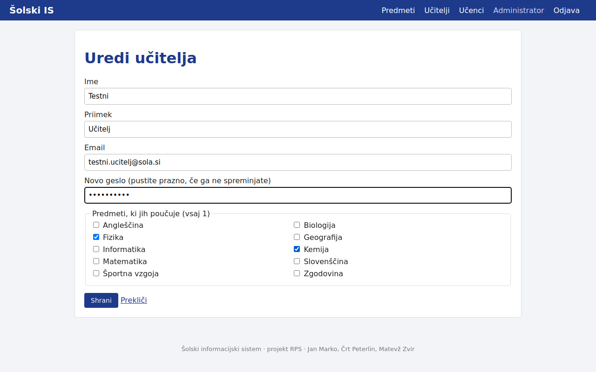

**T26: gradivo s šumniki v imenu**

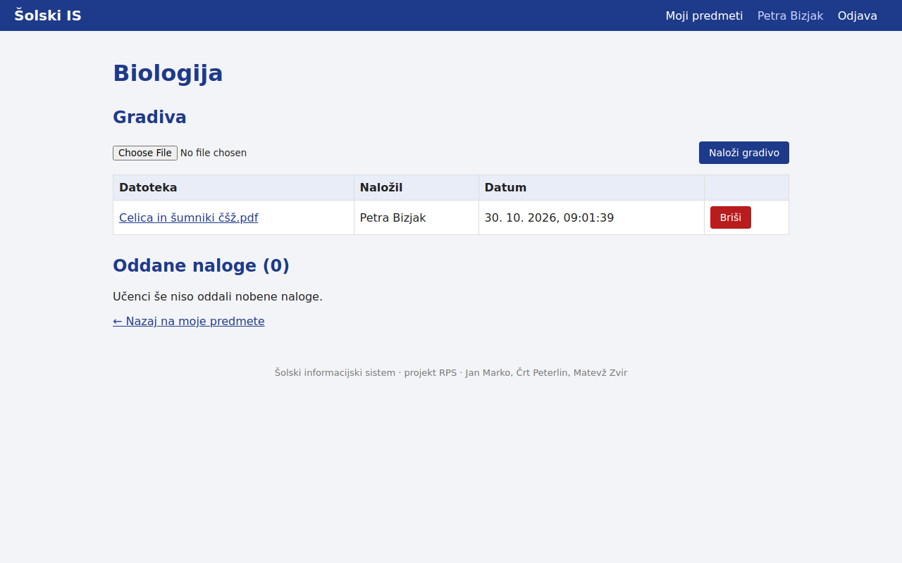

**T30: učitelj odpre predmet, ki ga ne poučuje (403)**

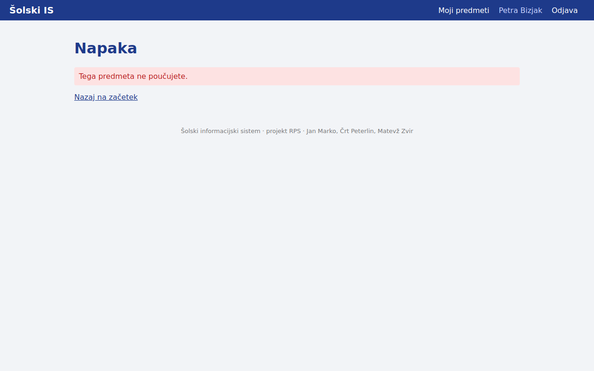

**T33: registracija, gesli se ne ujemata**

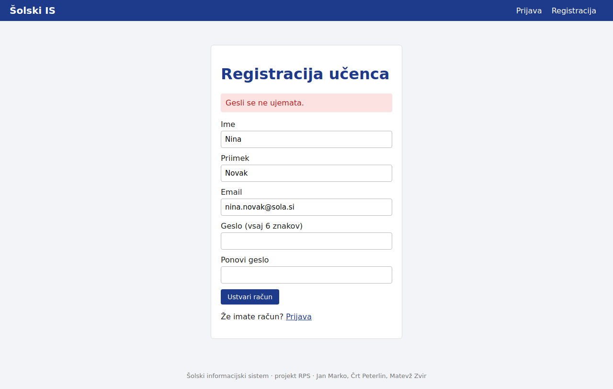

**T40: oddana naloga, ime "Priimek Ime - Naslov.pdf"**

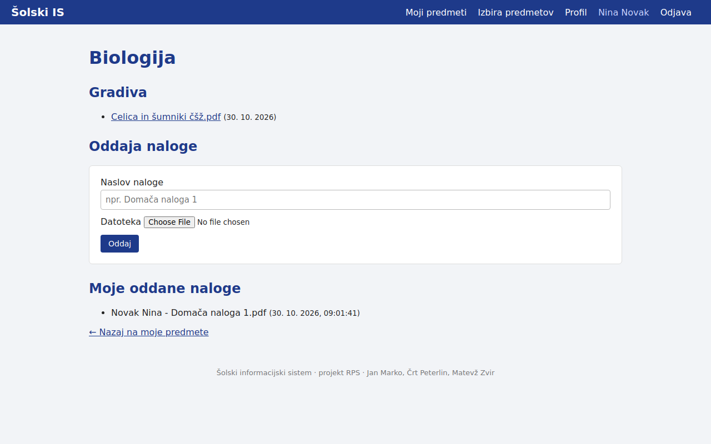

**T41: vprašanje pred ponovno oddajo**

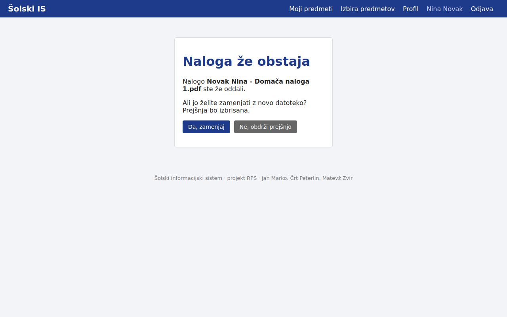

**T44: datoteka, večja od 20 MB**

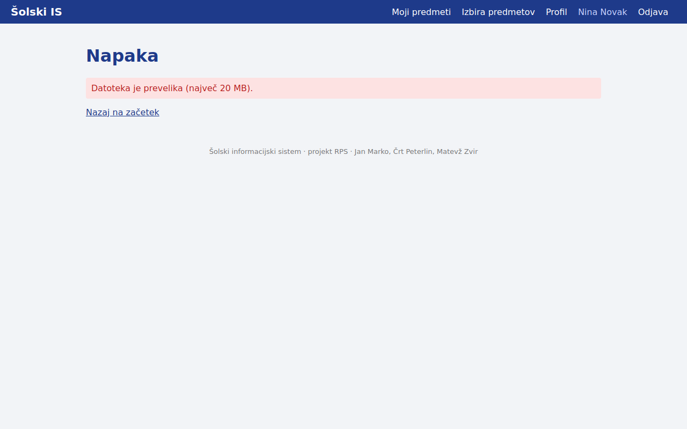

**T53: učiteljica vidi oddano nalogo**

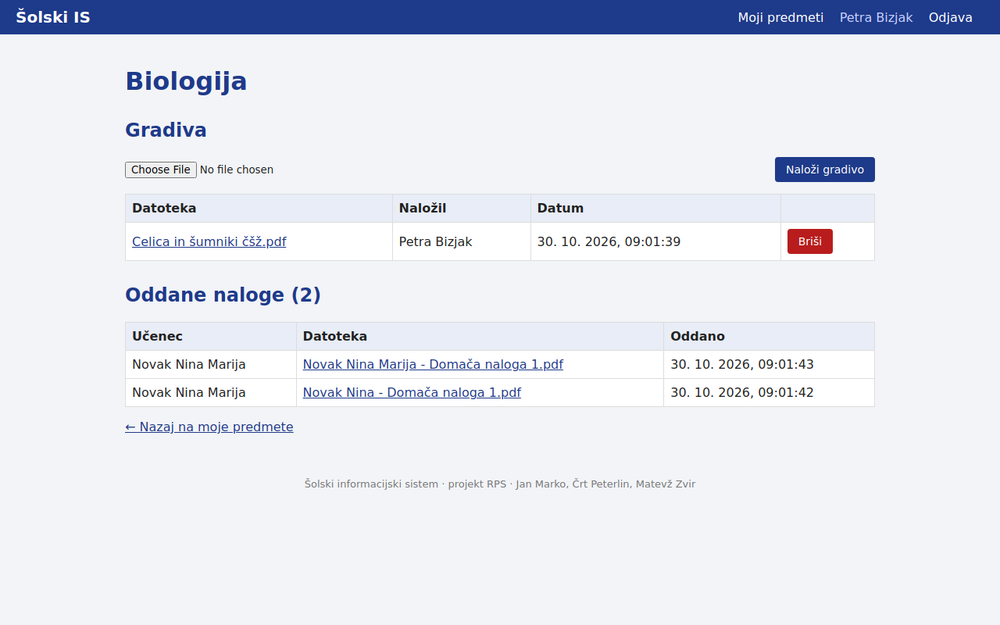

**T55: napaka 500 pri izbrisanem uporabniku (#5)**

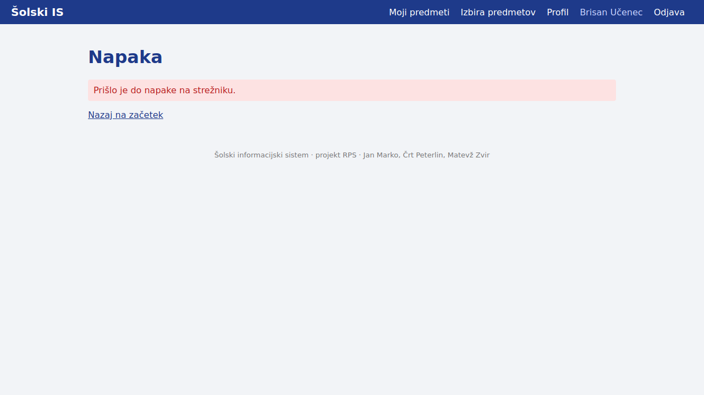

**T58: pogled učenca na telefonu**

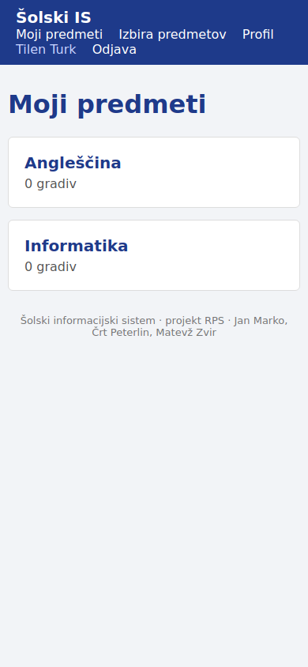

**T59: tabela na telefonu, premaknjena desno**

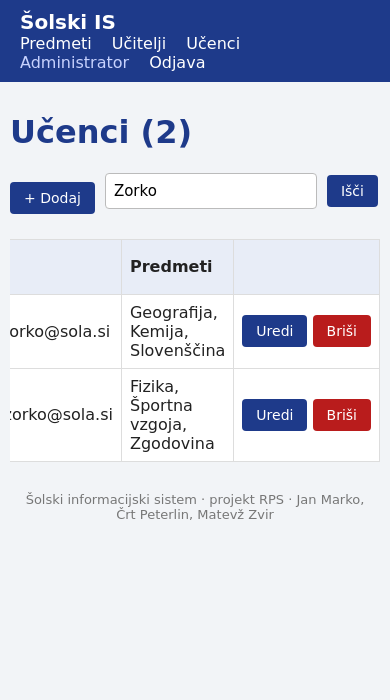
