# Uporabniška navodila

Avtor: Črt Peterlin

Šolski IS je spletna aplikacija za delo na daljavo. Odpre se v brskalniku na naslovu
**https://projekt.pajp.duckdns.org**, deluje tudi na telefonu.

Vsebina:
1. [Prijava in odjava](#1-prijava-in-odjava) (za vse)
2. [Administrator](#2-administrator)
3. [Učitelj](#3-učitelj)
4. [Učenec](#4-učenec)
5. [Pogosta vprašanja](#5-pogosta-vprašanja)

---

## 1. Prijava in odjava

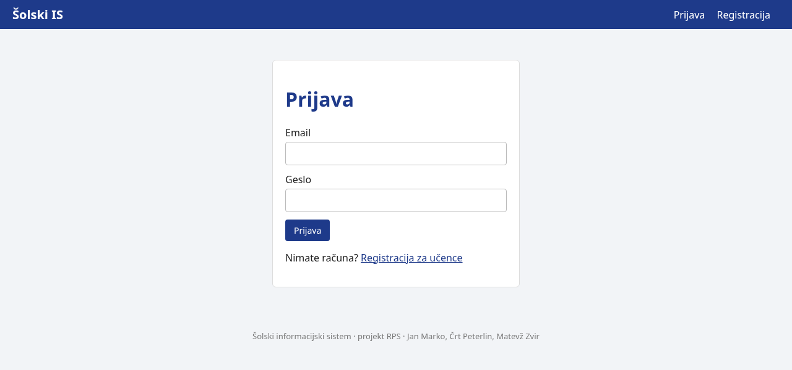

1. Odpri https://projekt.pajp.duckdns.org. Pokaže se stran za prijavo.
2. Vpiši svoj **email** in **geslo** ter klikni **Prijava**.
3. Aplikacija te sama odpelje na tvojo stran: administratorja na upravljanje šole, učitelja in
   učenca na seznam njegovih predmetov.

Za **odjavo** klikni **Odjava** desno zgoraj. Seja poteče sama po 2 urah.

Če vpišeš napačen email ali geslo, se pokaže "Napačen email ali geslo." Če si geslo pozabil,
ti novega nastavi administrator.

---

## 2. Administrator

Administrator vpisuje razrede, predmete, učitelje in učence ter določa, kdo uči kateri predmet v
katerem razredu in kateri predmet obiskuje učenec. Na domači strani vidi, koliko je razredov,
predmetov, učiteljev, učencev, nalog in oddaj.

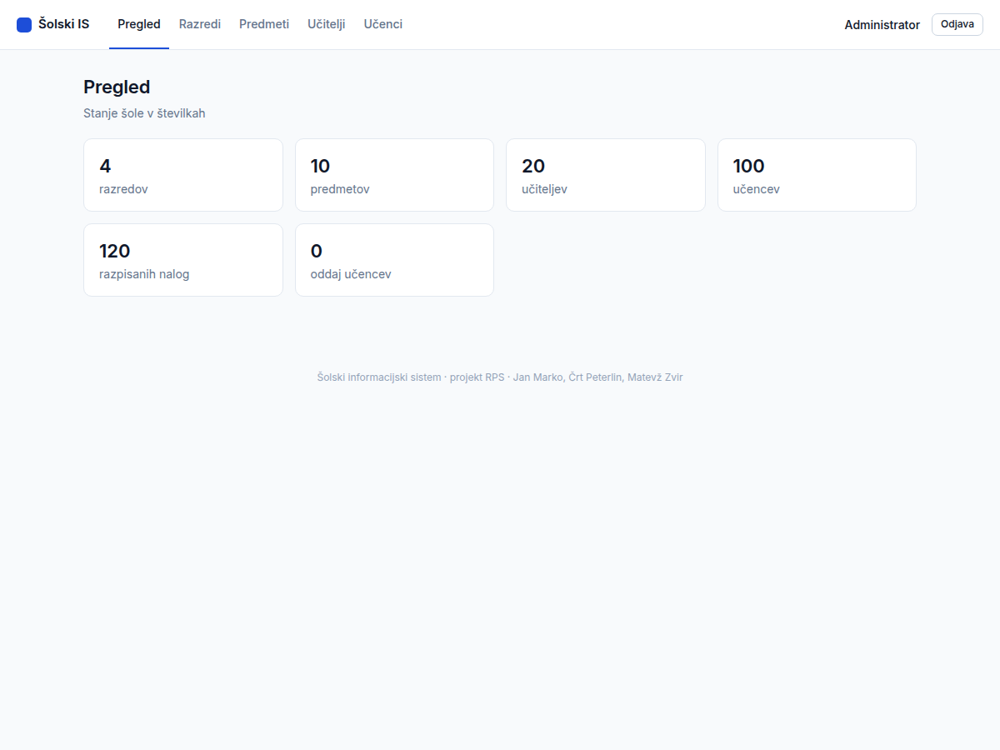

### Razredi
- **Dodaj:** v polje *Naziv novega razreda* vpiši npr. `1.B` in klikni **Dodaj**.
- **Uredi:** klikni **Uredi** ali ime razreda. Spremeniš naziv, spodaj pa vidiš, kdo uči kateri
  predmet v razredu in seznam učencev razreda.
- Število učencev v tabeli je povezava na seznam učencev tega razreda.
- **Briši:** klikni **Briši** in potrdi. Učenci ostanejo brez razreda, naloge in gradiva razreda se
  izbrišejo.

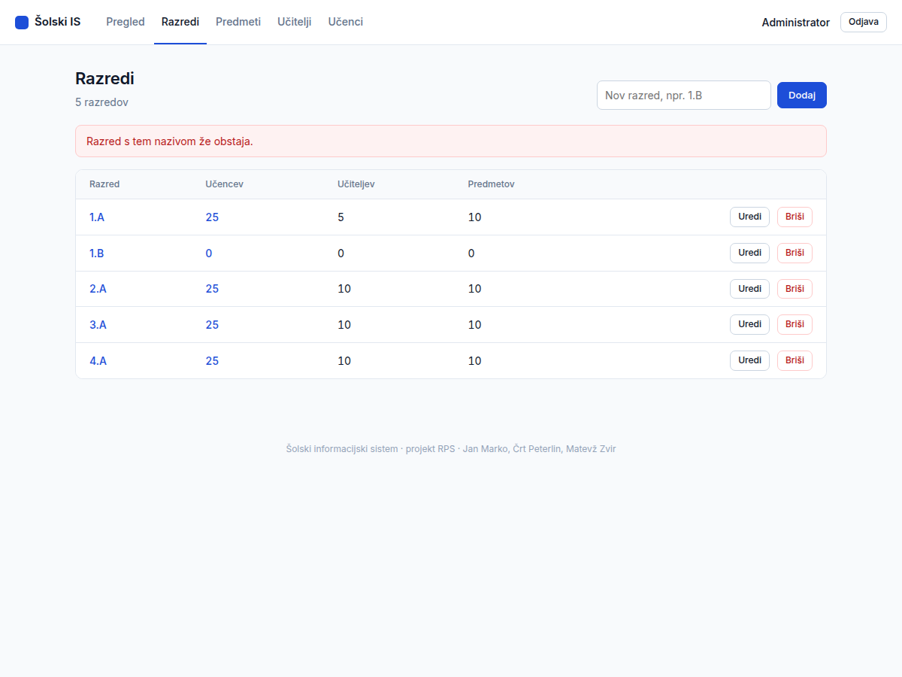

### Predmeti
- **Dodaj:** v polje *Naziv novega predmeta* vpiši ime in klikni **Dodaj**. Dva predmeta ne
  moreta imeti istega imena.
- **Uredi:** pri predmetu klikni **Uredi**, spremeni naziv in klikni **Shrani**.
- **Briši:** klikni **Briši** in potrdi. Pozor: s predmetom se izbrišejo tudi vsa njegova
  gradiva in oddane naloge.

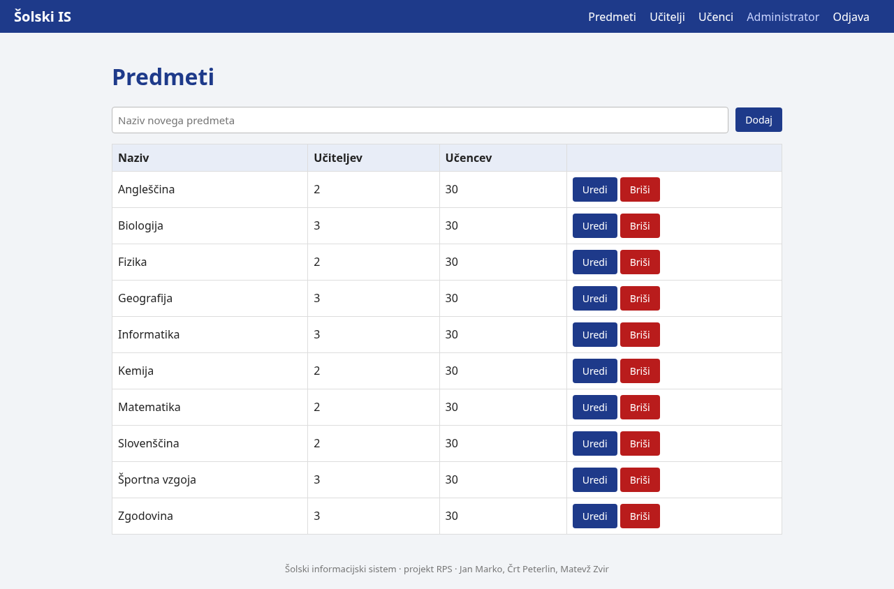

### Učitelji in učenci
Oba seznama delujeta enako.

- **Iskanje:** vpiši del imena ali priimka in klikni **Išči**.
- **Dodaj:** klikni **+ Dodaj**, izpolni ime, priimek, email in geslo (vsaj 6 znakov).
  - **Učitelj:** v mreži obkljukaj, kateri predmet uči v katerem razredu (vrstice so predmeti,
    stolpci razredi). Vsaj ena kljukica.
  - **Učenec:** izberi razred in obkljukaj vsaj **2** predmeta.
- **Učence po razredu:** na seznamu učencev izberi razred in klikni **Išči**.
- **Uredi:** klikni **Uredi**. Spremeniš lahko podatke in predmete. Polje *geslo* pusti prazno,
  če gesla ne želiš spremeniti; če vpišeš novo, se uporabnik od zdaj prijavlja z njim.
- **Briši:** klikni **Briši** in potrdi. Izbriše se račun skupaj s povezavami do predmetov.

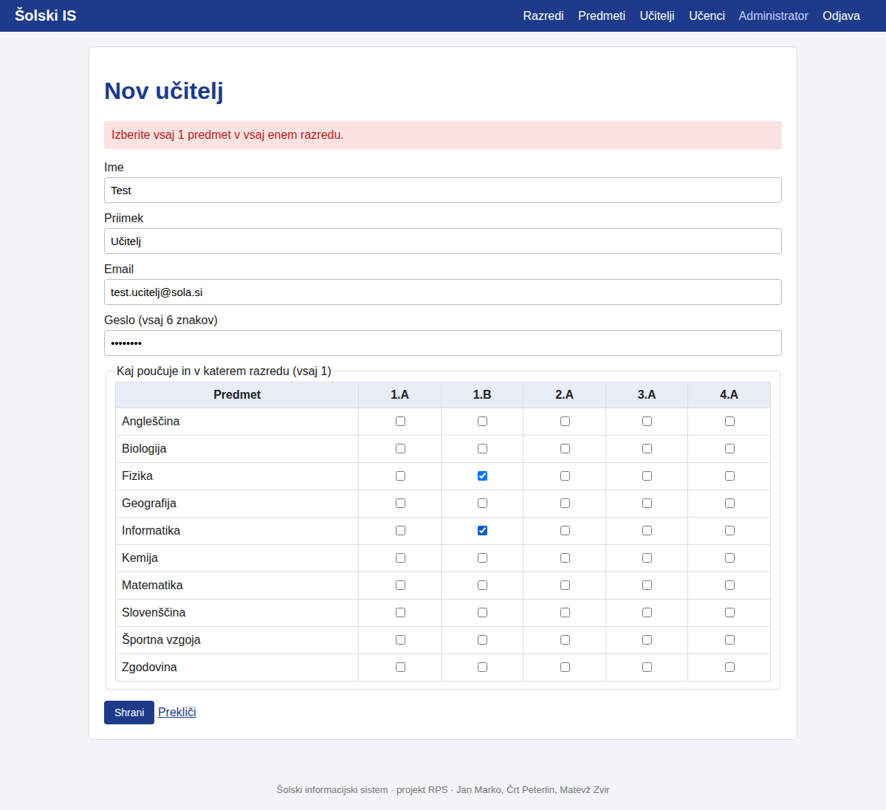

Na telefonu se tabela premika levo-desno; gumba **Uredi** in **Briši** sta na desni.

---

## 3. Učitelj

Na domači strani je kartica za vsak predmet v vsakem razredu, kjer poučuješ (npr. *Matematika 1.A*),
s številom učencev in nalog. Oranžna oznaka pove, koliko oddaj še čaka na oceno. Spodaj so
prihajajoči roki. Drugih predmetov in razredov ne vidiš.

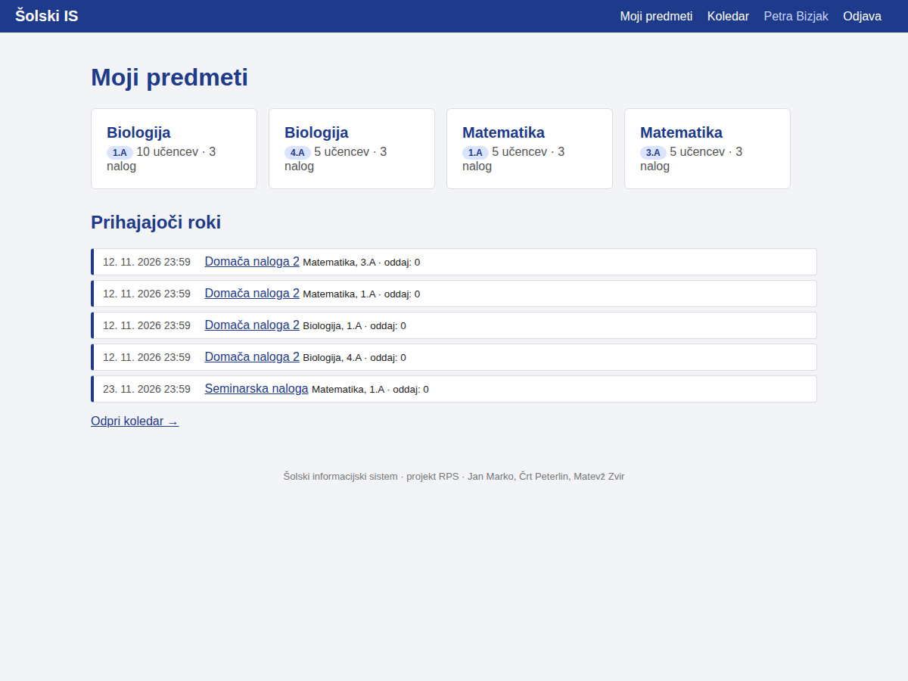

### Naloge
- **Razpiši:** v skupini klikni **+ Razpiši novo nalogo**, vpiši naslov, navodila in rok (datum in
  uro) ter klikni **Razpiši**. Nalogo takoj vidijo učenci tega razreda.
- V tabeli nalog vidiš, koliko učencev je oddalo in koliko oddaj je ocenjenih.
- **Odpri nalogo:** klikni njen naslov. Vidiš vse učence razreda in stanje vsakega:
  *Oddano*, *Oddano z zamudo*, *Ni oddano* (rok je potekel) ali *Odprto* (rok še ni potekel).
- **Ocena:** pri učencu izberi oceno 1 do 5, po želji napiši komentar in klikni **Shrani**. Učenec
  oceno in komentar takoj vidi. Če izbereš *brez ocene*, se ocena odstrani.
- **Uredi** spremeni naslov, navodila ali rok, **Briši nalogo** izbriše nalogo z vsemi oddajami.

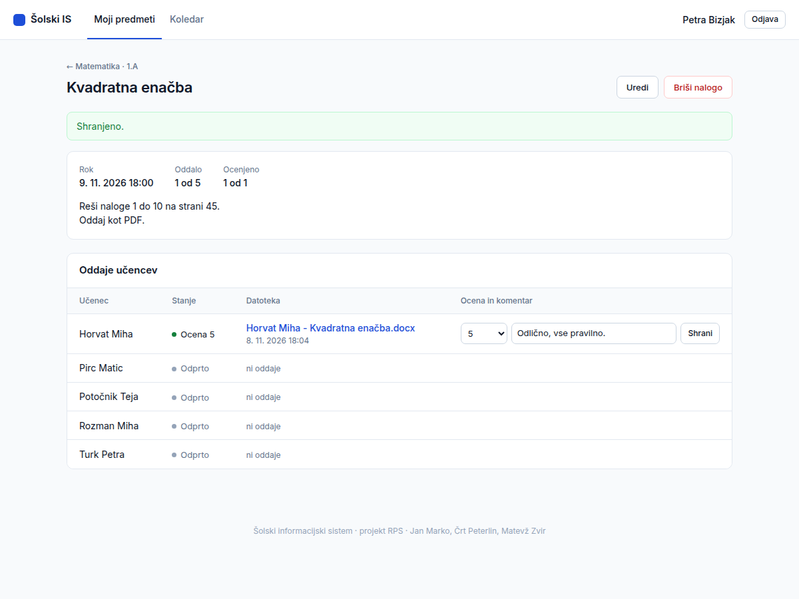

### Gradiva
- **Naloži:** v skupini klikni *Izberi datoteko*, izberi datoteko (največ 20 MB) in klikni
  **Naloži gradivo**. Gradivo takoj vidijo učenci tega razreda.
- **Prenesi:** klikni ime gradiva.
- **Briši:** klikni **Briši** pri gradivu in potrdi.

### Oddane naloge
Ime datoteke je vedno `Priimek Ime - Naslov naloge`, zato takoj vidiš, čigava je. Klikni ime, da
nalogo preneseš. Naloge, ki jih učenci oddajo brez razpisane naloge, so na dnu skupine pod
*Druge oddaje*, tudi tam jih lahko oceniš.

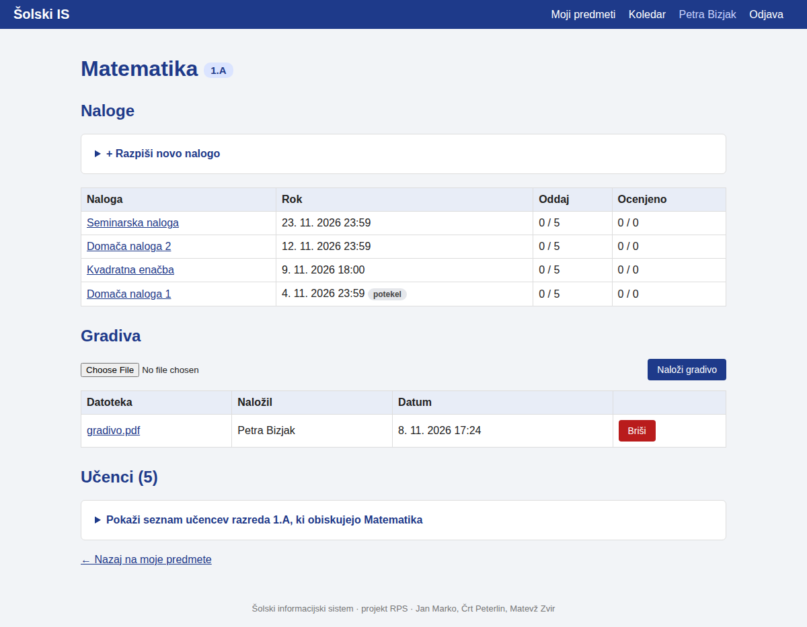

### Koledar
V meniju klikni **Koledar**. Vidiš roke vseh svojih nalog po dnevih; s puščicama greš na prejšnji
ali naslednji mesec. Klik na nalogo jo odpre.

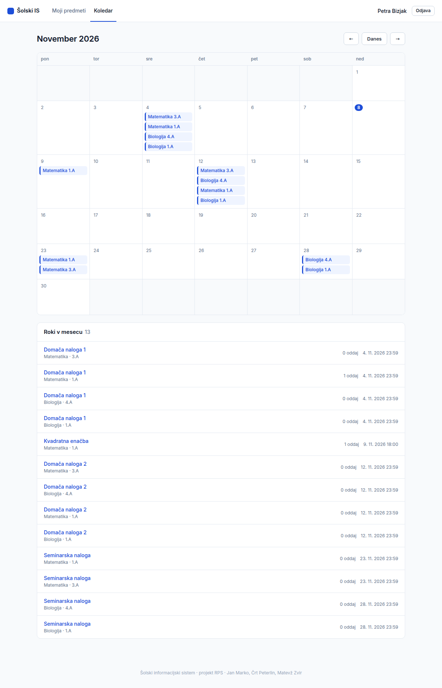

---

## 4. Učenec

### Registracija
1. Na strani za prijavo klikni **Registracija za učence**.
2. Vpiši ime, priimek, email, izberi svoj **razred** in dvakrat vpiši geslo (vsaj 6 znakov).
   Klikni **Ustvari račun**.
3. Takoj si prijavljen in izbereš predmete.

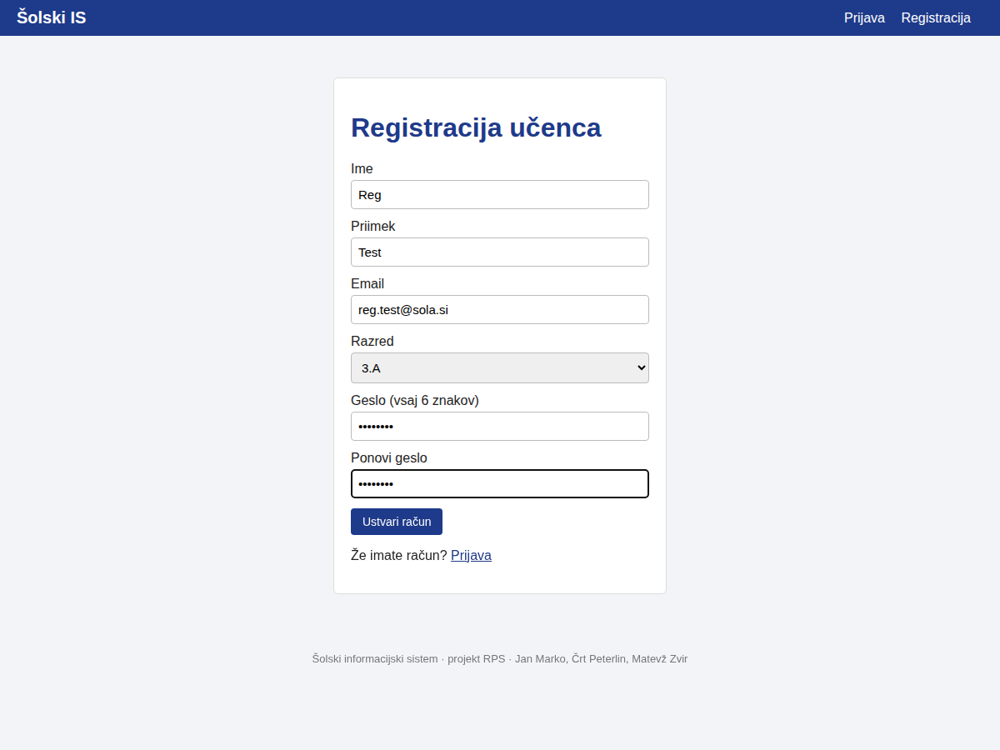

### Izbira predmetov
V meniju klikni **Izbira predmetov**, obkljukaj predmete, ki jih obiskuješ (vsaj **2**), in klikni
**Shrani**. Seznam lahko kadarkoli spremeniš.

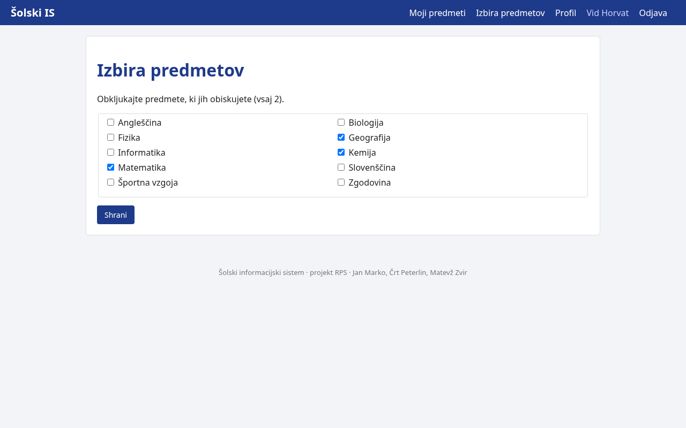

### Domača stran
Na domači strani (**Moji predmeti**) so tvoji predmeti z imenom učitelja in številom odprtih nalog.
Pod njimi je seznam *Za oddati*: naloge, ki jih še nisi oddal, po roku. Zamujene so označene rdeče.

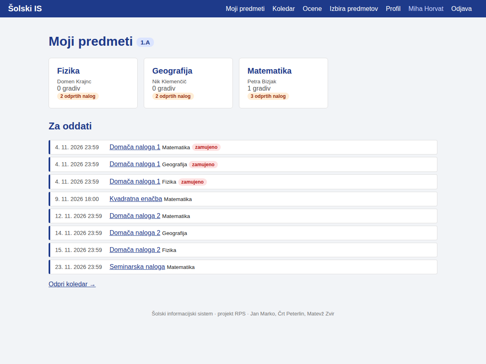

### Gradiva in naloge
Klikni predmet. Zgoraj so naloge, ki jih je razpisal učitelj, z rokom in stanjem, spodaj gradiva;
klikni ime gradiva, da ga preneseš.

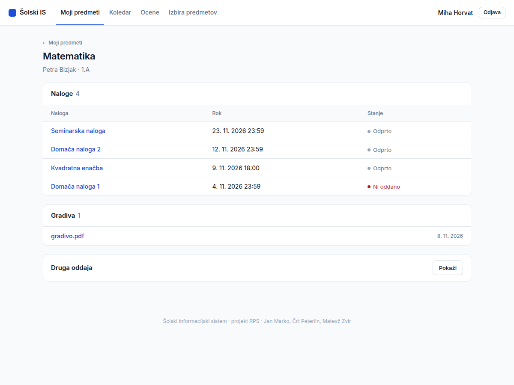

### Oddaja naloge
1. Pri predmetu klikni nalogo. Prebereš navodila in rok.
2. Izberi datoteko (največ 20 MB) in klikni **Oddaj**.

Datoteka se shrani kot `Priimek Ime - Naslov naloge` z enako končnico, kot jo ima tvoja datoteka
(npr. `Horvat Miha - Kvadratna enačba.pdf`). Oddajo lahko kadarkoli preneseš nazaj s klikom na ime.
Če oddaš po roku, je naloga označena *Oddano z zamudo*. Ko jo učitelj oceni, pod oddajo vidiš oceno
in komentar; ocenjene naloge ne moreš več zamenjati.

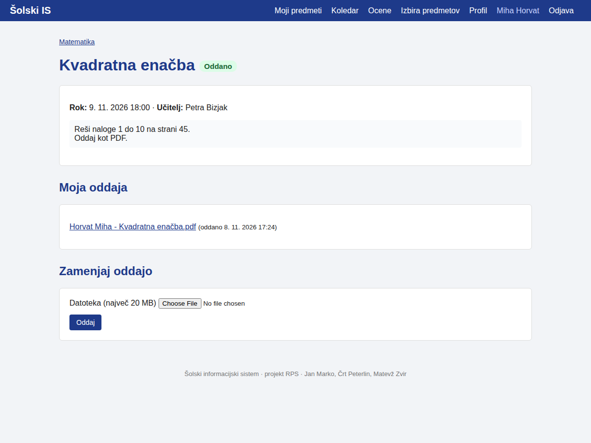

**Druga oddaja:** če moraš oddati nekaj, česar učitelj ni razpisal, na strani predmeta odpri *Druga
oddaja* (gumb **Pokaži**), vpiši naslov in izberi datoteko.

**Ponovna oddaja:** če nalogo oddaš še enkrat, te aplikacija vpraša, ali želiš zamenjati prejšnjo
oddajo. **Da, zamenjaj** prejšnjo datoteko zamenja z novo, **Ne, obdrži prejšnjo** pa novo
datoteko zavrže.

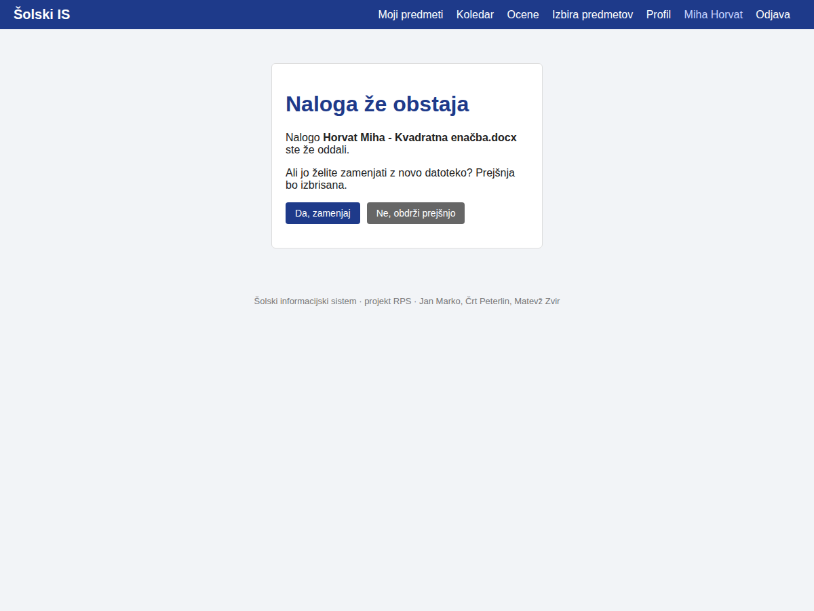

### Ocene
V meniju klikni **Ocene**. Vidiš vse ocene in komentarje po predmetih s povprečjem.

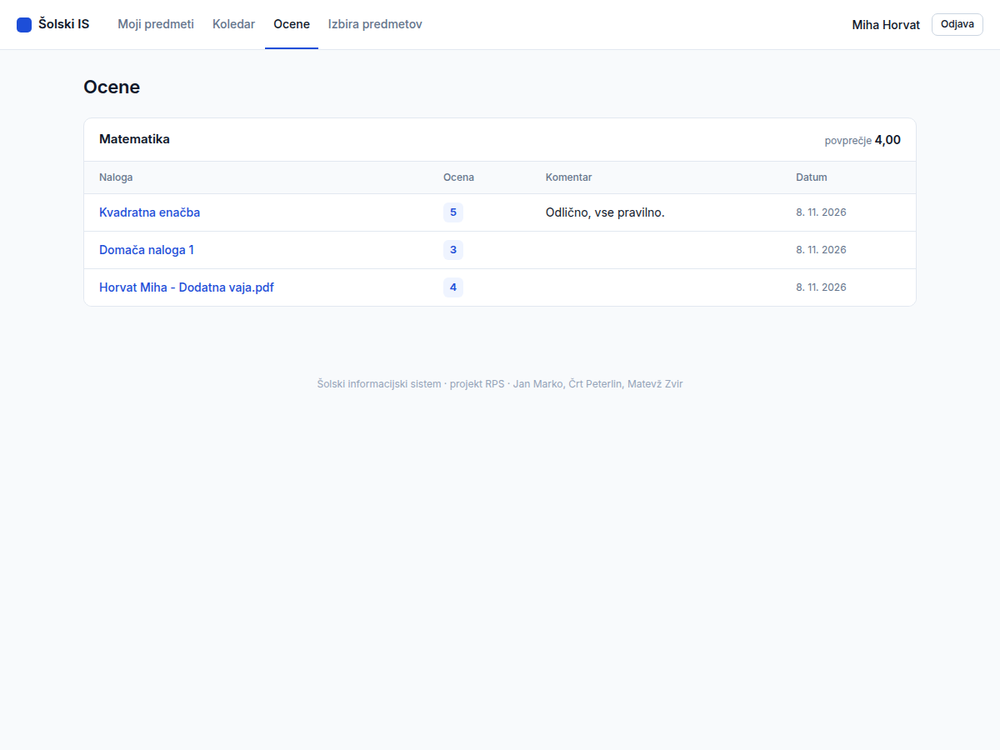

### Koledar
V meniju klikni **Koledar**. Roki vseh nalog v mesecu, obarvani po stanju: zeleno oddano, oranžno z
zamudo, rdeče neoddano, sivo še odprto. Na telefonu so roki prikazani kot seznam.

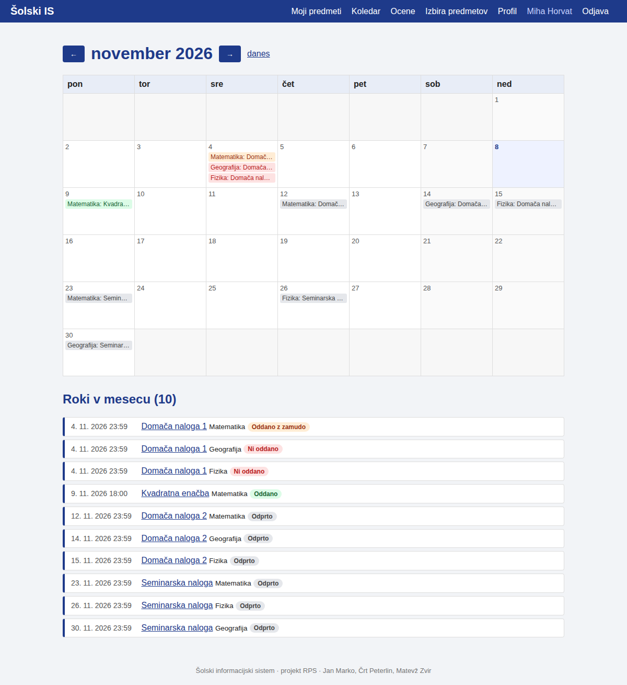

### Profil
Klikni svoje ime desno zgoraj. Spremeniš lahko ime, priimek in email. Razred vidiš, spremeni ga
administrator. Polje za geslo pusti prazno,
če gesla ne menjaš. Klikni **Shrani**.

---

## 5. Pogosta vprašanja

| Vprašanje | Odgovor |
|---|---|
| Pozabil sem geslo. | Novo geslo ti nastavi administrator. |
| Ne vidim predmeta. | Učenec: dodaj ga v *Izbira predmetov*. Učitelj: predmet v razredu ti dodeli administrator. |
| Ne vidim nobene naloge. | Morda ti razred še ni določen (piše na domači strani). Obrni se na administratorja. |
| Nalogo sem oddal narobe, ocenjena je že. | Ocenjene naloge ne moreš zamenjati; piši učitelju, da oceno odstrani. |
| Piše "Do te strani nimate dostopa." | Odprl si stran, ki ni za tvojo vlogo (npr. učenec stran administratorja). |
| Piše "Datoteka je prevelika." | Največja dovoljena velikost je 20 MB. Datoteko stisni (zip) ali zmanjšaj. |
| Ali učitelj vidi mojo nalogo, preden potrdim zamenjavo? | Ne. Učitelj vidi samo potrjene oddaje. |
