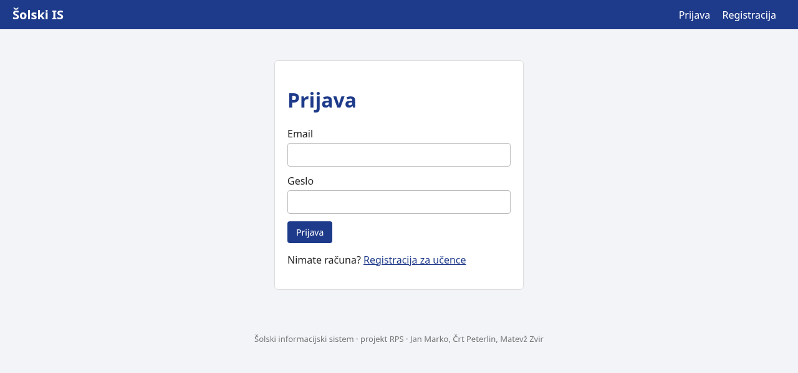
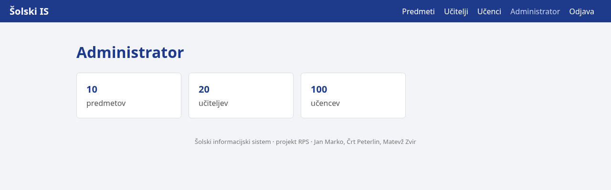
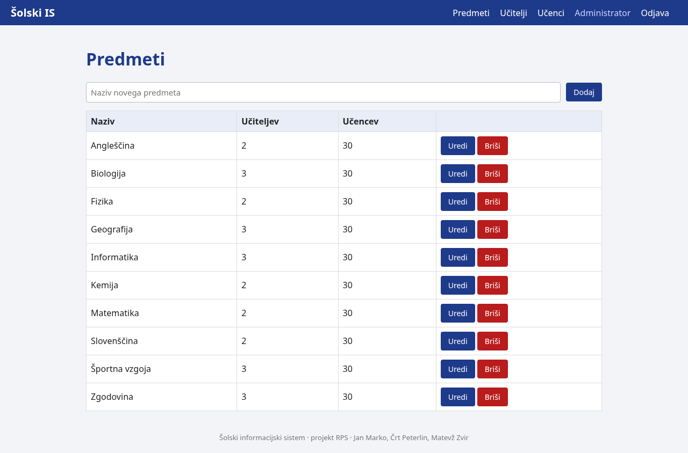
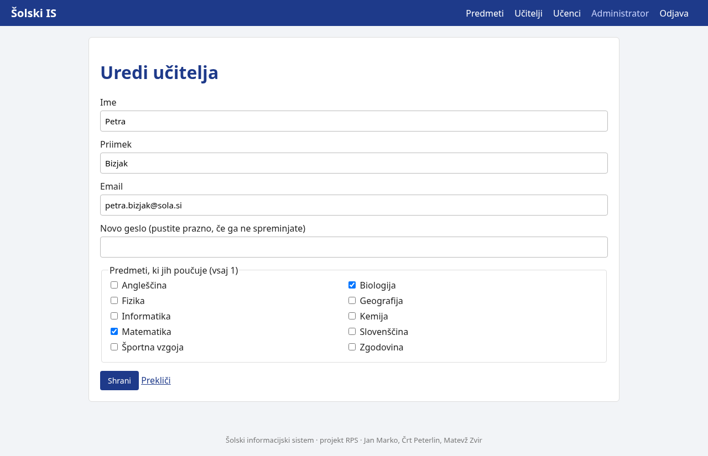
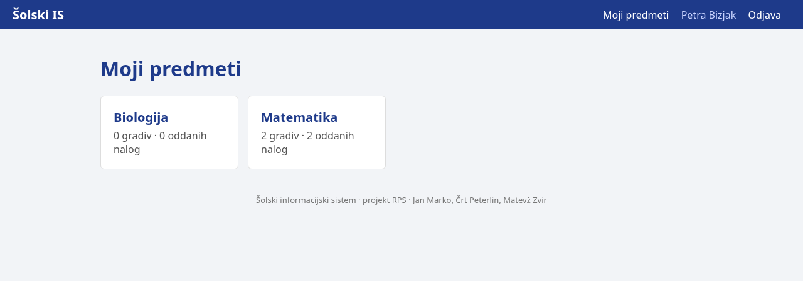
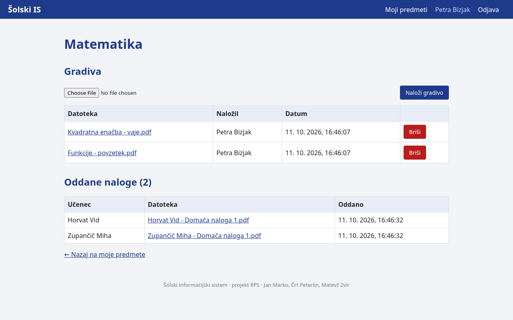
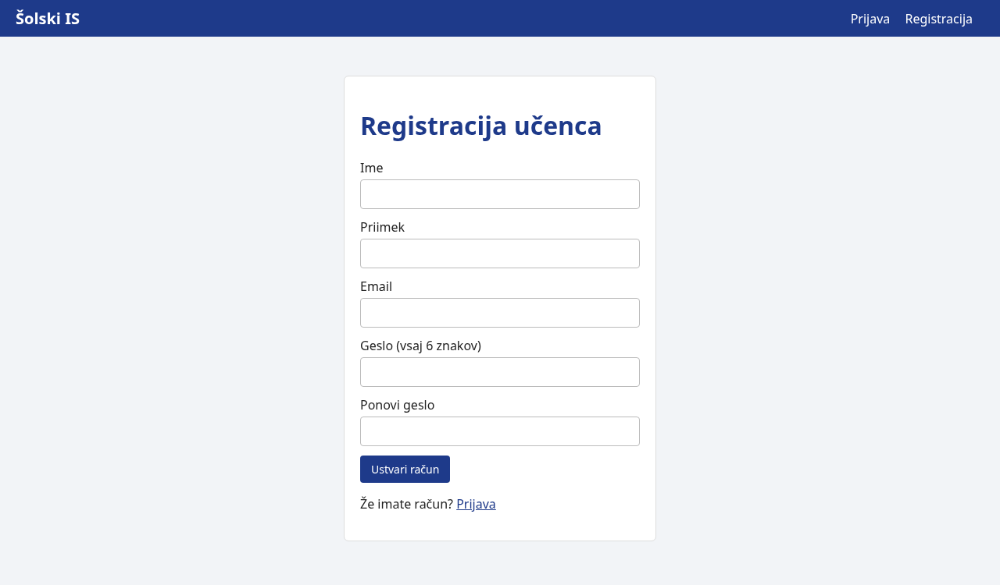
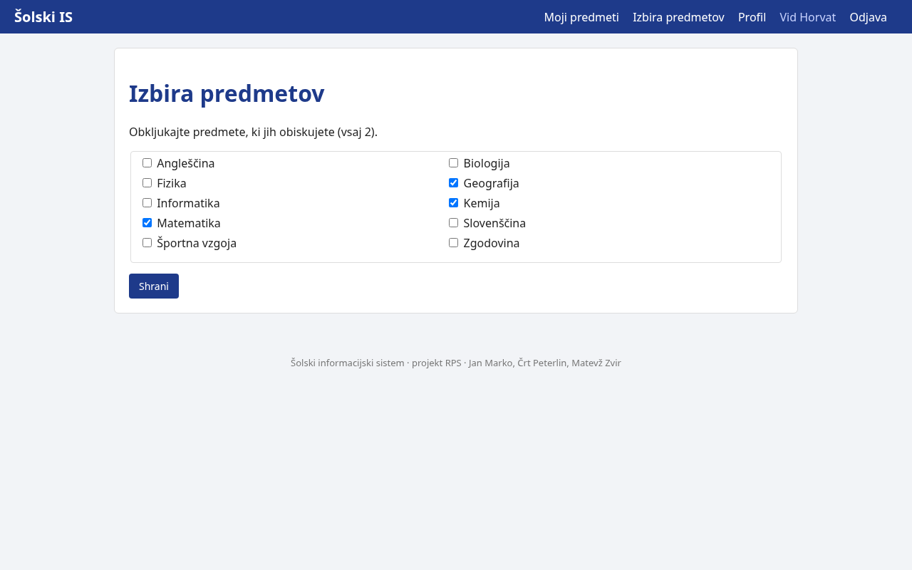
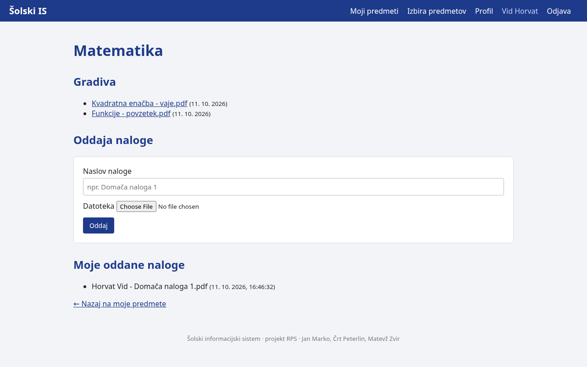
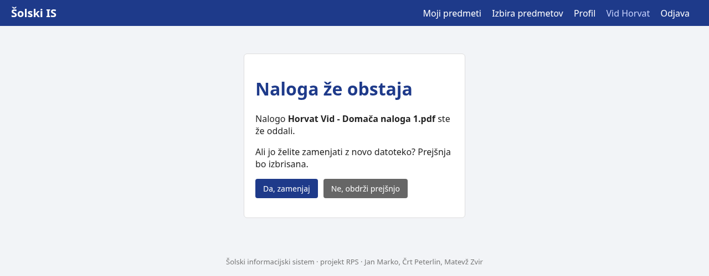

# Uporabniška navodila

Avtor: Črt Peterlin

Šolski IS je spletna aplikacija za delo na daljavo. Odpre se v brskalniku na naslovu
**https://projekt.pajp.duckdns.org**, deluje tudi na telefonu.

Vsebina:
1. [Prijava in odjava](#1-prijava-in-odjava) (za vse)
2. [Administrator](#2-administrator)
3. [Učitelj](#3-učitelj)
4. [Učenec](#4-učenec)
5. [Pogosta vprašanja](#5-pogosta-vprašanja)

---

## 1. Prijava in odjava

1. Odpri https://projekt.pajp.duckdns.org. Pokaže se stran za prijavo.
2. Vpiši svoj **email** in **geslo** ter klikni **Prijava**.
3. Aplikacija te sama odpelje na tvojo stran: administratorja na upravljanje šole, učitelja in
   učenca na seznam njegovih predmetov.

Za **odjavo** klikni **Odjava** desno zgoraj. Seja poteče sama po 2 urah.

Če vpišeš napačen email ali geslo, se pokaže "Napačen email ali geslo." Če si geslo pozabil,
ti novega nastavi administrator.

---

## 2. Administrator

Administrator vpisuje predmete, učitelje in učence ter določa, kdo uči oziroma obiskuje kateri
predmet. Na domači strani vidi, koliko je predmetov, učiteljev in učencev.

### Predmeti
- **Dodaj:** v polje *Naziv novega predmeta* vpiši ime in klikni **Dodaj**. Dva predmeta ne
  moreta imeti istega imena.
- **Uredi:** pri predmetu klikni **Uredi**, spremeni naziv in klikni **Shrani**.
- **Briši:** klikni **Briši** in potrdi. Pozor: s predmetom se izbrišejo tudi vsa njegova
  gradiva in oddane naloge.

### Učitelji in učenci
Oba seznama delujeta enako.

- **Iskanje:** vpiši del imena ali priimka in klikni **Išči**.
- **Dodaj:** klikni **+ Dodaj**, izpolni ime, priimek, email in geslo (vsaj 6 znakov) ter
  obkljukaj predmete. Učitelj mora učiti vsaj **1** predmet, učenec obiskovati vsaj **2**.
- **Uredi:** klikni **Uredi**. Spremeniš lahko podatke in predmete. Polje *geslo* pusti prazno,
  če gesla ne želiš spremeniti; če vpišeš novo, se uporabnik od zdaj prijavlja z njim.
- **Briši:** klikni **Briši** in potrdi. Izbriše se račun skupaj s povezavami do predmetov.

Na telefonu se tabela premika levo-desno; gumba **Uredi** in **Briši** sta na desni.

---

## 3. Učitelj

Na domači strani so predmeti, ki jih poučuješ, s številom gradiv in oddanih nalog. Klikni
predmet, da ga odpreš. Drugih predmetov ne vidiš.

### Gradiva
- **Naloži:** pri predmetu klikni *Izberi datoteko*, izberi datoteko (največ 20 MB) in klikni
  **Naloži gradivo**. Gradivo takoj vidijo vsi učenci tega predmeta.
- **Prenesi:** klikni ime gradiva.
- **Briši:** klikni **Briši** pri gradivu in potrdi.

### Oddane naloge
Pod gradivi je seznam nalog, ki so jih oddali učenci. Ime datoteke je vedno
`Priimek Ime - Naslov naloge`, zato takoj vidiš, čigava je. Klikni ime, da nalogo preneseš.

---

## 4. Učenec

### Registracija
1. Na strani za prijavo klikni **Registracija za učence**.
2. Vpiši ime, priimek, email in dvakrat geslo (vsaj 6 znakov). Klikni **Ustvari račun**.
3. Takoj si prijavljen in izbereš predmete.

### Izbira predmetov
V meniju klikni **Izbira predmetov**, obkljukaj predmete, ki jih obiskuješ (vsaj **2**), in klikni
**Shrani**. Seznam lahko kadarkoli spremeniš.

### Gradiva
Na domači strani (**Moji predmeti**) klikni predmet. Zgoraj so gradiva učiteljev; klikni ime,
da gradivo preneseš.

### Oddaja naloge
1. Odpri predmet.
2. Pod *Oddaja naloge* vpiši **naslov** (npr. "Domača naloga 1") in izberi datoteko (največ 20 MB).
3. Klikni **Oddaj**.

Datoteka se shrani kot `Priimek Ime - Naslov naloge` z enako končnico, kot jo ima tvoja datoteka
(npr. `Novak Nina - Domača naloga 1.pdf`). Oddane naloge vidiš pod naslovom *Moje oddane naloge*.

**Ponovna oddaja:** če oddaš nalogo z istim naslovom še enkrat, te aplikacija vpraša, ali želiš
zamenjati prejšnjo oddajo. **Da, zamenjaj** prejšnjo datoteko povozi z novo, **Ne, obdrži
prejšnjo** pa novo datoteko zavrže.

### Profil
V meniju klikni **Profil**. Spremeniš lahko ime, priimek in email. Polje za geslo pusti prazno,
če gesla ne menjaš. Klikni **Shrani**.

---

## 5. Pogosta vprašanja

| Vprašanje | Odgovor |
|---|---|
| Pozabil sem geslo. | Novo geslo ti nastavi administrator. |
| Ne vidim predmeta. | Učenec: dodaj ga v *Izbira predmetov*. Učitelj: predmet ti dodeli administrator. |
| Piše "Do te strani nimate dostopa." | Odprl si stran, ki ni za tvojo vlogo (npr. učenec stran administratorja). |
| Piše "Datoteka je prevelika." | Največja dovoljena velikost je 20 MB. Datoteko stisni (zip) ali zmanjšaj. |
| Ali učitelj vidi mojo nalogo, preden potrdim zamenjavo? | Ne. Učitelj vidi samo potrjene oddaje. |
